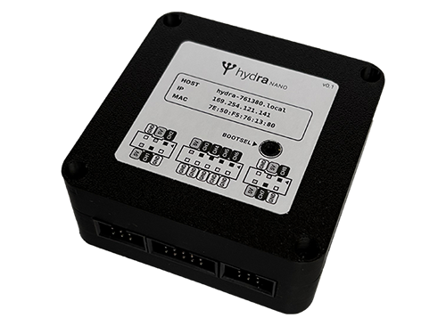

# hydra nano

[](LICENSE)
[](flake.nix)
[](pcb/ato.yaml)

**hydra nano** is an open-source, ultra-compact 8-channel sACN (E1.31) lighting output controller. Powered by a Raspberry Pi Pico (RP2040) and a WIZnet W5500 SPI Ethernet module, it drives WS2812B addressable LED strings (via RP2040 PIO state machines) or high-frequency hardware PWM dimmers, configurable via a web interface.



---

## Features

- **8 Independent Output Channels**, each supporting one of the following modes:
  - **WS2812B Pixel Mode**: Up to 1,000 pixels per channel.
  - **WS2812B Uniform Fill Mode**: Controls an entire strip with a single DMX RGB slot triplet.
  - **PWM Dimming**: High-frequency PWM for MOSFET-switched single-color fixtures.
- **sACN Protocol Support**:
  - Listens on multicast and unicast UDP port `5568`.
  - Configurable stream loss behavior per channel: **Hold**, **Blackout**, or timed **Fade**.
- **Robust Networking & Zero-Conf Discovery**:
  - Hardware TCP/IP offload via WIZnet W5500 10/100 Mbps Ethernet.
  - Automatic DHCP with auto-retry.
  - Deterministic fallback link-local IPv4 (`169.254.x.y`) derived from hardware UID.
  - mDNS announcement (`<hostname>.local`, `_http._tcp`, `_hydra_nano._tcp`) and ICMP ping support.
- **Embedded Web Management Server**:
  - Simple responsive web UI on port 80 for live universe stream monitoring, network setup, channel configuration, and interactive test pattern generation.
- **Code-Defined Hardware & Enclosure**:
  - Schematic and netlist defined in atopile code ([`pcb/main.ato`](pcb/main.ato)).
  - Level-shifted outputs (3.3V to 5V) with solder bypass jumpers.
  - Snap-fit 3D CAD enclosure models ([Onshape](https://cad.onshape.com/documents/83539edf775ddacd0b6ac004/w/c1c705bfbe98832503cfb8b5/e/50ee4a9a96b406c057eff376)) with label generator.

---

## Hardware Architecture

### Channel & GPIO Mapping

The 8 physical outputs are ordered West-to-East across the board headers:

| Channel | Label | RP2040 GPIO | PWM Slice / PIO | Level Shifter | Bypass Jumper | Output Connector |
| :---: | :---: | :---: | :---: | :---: | :---: | :---: |
| **Ch 1** | OUT 1 | `GP15` | PWM Slice 7 B / PIO0 SM0 | Shifter `A1` $\rightarrow$ `B1` | `SJ1` | IDC 6-Pin #1 Pin 4 |
| **Ch 2** | OUT 2 | `GP14` | PWM Slice 7 A / PIO0 SM1 | Shifter `A2` $\rightarrow$ `B2` | `SJ2` | IDC 6-Pin #1 Pin 1 |
| **Ch 3** | OUT 3 | `GP13` | PWM Slice 6 B / PIO0 SM2 | Shifter `A3` $\rightarrow$ `B3` | `SJ3` | IDC 10-Pin Pin 7 |
| **Ch 4** | OUT 4 | `GP12` | PWM Slice 6 A / PIO0 SM3 | Shifter `A4` $\rightarrow$ `B4` | `SJ4` | IDC 10-Pin Pin 5 |
| **Ch 5** | OUT 5 | `GP11` | PWM Slice 5 B / PIO1 SM0 | Shifter `A5` $\rightarrow$ `B5` | `SJ5` | IDC 10-Pin Pin 3 |
| **Ch 6** | OUT 6 | `GP10` | PWM Slice 5 A / PIO1 SM1 | Shifter `A6` $\rightarrow$ `B6` | `SJ6` | IDC 10-Pin Pin 1 |
| **Ch 7** | OUT 7 | `GP9` | PWM Slice 4 B / PIO1 SM2 | Shifter `A7` $\rightarrow$ `B7` | `SJ7` | IDC 6-Pin #2 Pin 4 |
| **Ch 8** | OUT 8 | `GP8` | PWM Slice 4 A / PIO1 SM3 | Shifter `A8` $\rightarrow$ `B8` | `SJ8` | IDC 6-Pin #2 Pin 1 |

---

### W5500 Ethernet SPI Wiring

The W5500 module is connected to RP2040 hardware `SPI0`:

| Signal | Pico GPIO | Pico Pin | W5500 Pin | Function |
| :--- | :---: | :---: | :---: | :--- |
| **MISO** | `GP0` | Pin 1 | Pin 12 | SPI0 RX / Master In Slave Out |
| **RSTn** | `GP1` | Pin 2 | Pin 11 | Active-low hardware reset |
| **SCK** | `GP2` | Pin 4 | Pin 4 | SPI0 Clock |
| **MOSI** | `GP3` | Pin 5 | Pin 3 | SPI0 TX / Master Out Slave In |
| **INTn / IRQ**| `GP4` | Pin 6 | Pin 6 | Active-low interrupt line |
| **CSn** | `GP5` | Pin 7 | Pin 5 | Active-low SPI Chip Select |

---

### IDC Headers & Connectors

Outputs are distributed via standard 2.54 mm pitch right-angle shrouded box headers:

- **IDC 6-Pin Header #1**:
  - Pin 1: `Ch 2` (GP14) | Pin 2: `GND` | Pin 3: `5V`
  - Pin 4: `Ch 1` (GP15) | Pin 5: `GND` | Pin 6: `5V`
- **IDC 10-Pin Header**:
  - Odd pins (signals/power): Pin 1: `Ch 6` (GP10), Pin 3: `Ch 5` (GP11), Pin 5: `Ch 4` (GP12), Pin 7: `Ch 3` (GP13), Pin 9: `5V`
  - Even pins: Dedicated ground lines (Pins 2, 4, 6, 8, 10: `GND`)
- **IDC 6-Pin Header #2**:
  - Pin 1: `Ch 8` (GP8) | Pin 2: `GND` | Pin 3: `5V`
  - Pin 4: `Ch 7` (GP9) | Pin 5: `GND` | Pin 6: `5V`

---

## Firmware

The firmware is written in async Rust using the **Embassy** framework.

1. **Core 0 (Networking & Control)**:
   - Manages SPI transactions with the W5500.
   - Parses incoming sACN packets and updates atomic universe double-buffers.
   - Runs the embedded web server, responds to mDNS queries, and monitors DHCP leases.
   - Manages non-volatile flash writes when configuration changes occur.
2. **Core 1 (Real-Time Output Generation)**:
   - Dedicated exclusively to output generation, isolated from network interrupts.
   - Dispatches parallel DMA transfers to PIO0 and PIO1 state machines for 800 kHz WS2812 timing.
   - Updates hardware PWM compare registers and computes flame simulation frames.

## Getting Started & Development

### Environment Setup (Nix Flake)

The repository provides reproducible Nix development shells for both PCB design and firmware development:

```bash
# Enter the firmware dev shell (Rust toolchain, picotool, defmt-print, probe-rs)
nix develop .#firmware

# Enter the PCB dev shell (atopile, KiCad 10, librsvg)
nix develop .#pcb

# Or if using direnv:
direnv allow
```

---

### Firmware Development & Flashing

Within `firmware/` or inside the `.#firmware` shell:

```bash
# 1. Run host-side unit tests
cargo test -p sacn-core

# 2. Check embedded firmware target
cargo fw-check

# 3. Build release binary for RP2040
cargo fw-build

# 4. Flash over USB and automatically stream defmt logs
cargo fw-run

# 5. Flash via debug probe (e.g. Raspberry Pi Debug Probe / CMSIS-DAP)
cargo fw-run-probe

# 6. Preview the embedded Web UI in your desktop browser
cargo web-preview
```

#### Flashing Workflow (`fw-flash`)

The [`scripts/fw-flash`](firmware/scripts/fw-flash) script handles USB flashing without requiring physical access to the BOOTSEL button:
1. Reboots the board into the RP2040 ROM bootloader over USB serial (1200 baud pulse).
2. Erases the non-volatile configuration flash sector (`0x101FF000`) to guarantee fresh defaults (override with `FW_KEEP_CONFIG=1`).
3. Loads the ELF binary via `picotool`.
4. Spawns [`scripts/fw-logs`](firmware/scripts/fw-logs) to decode and stream structured `defmt` logs over USB CDC serial.

---

### PCB Build & EDA Workflow

The PCB is defined in atopile code ([`pcb/main.ato`](pcb/main.ato)) and laid out in KiCad ([`pcb/layouts/hydra-nano`](pcb/layouts/hydra-nano)):

```bash
# Enter PCB shell
nix develop .#pcb

cd pcb

# Build KiCad netlist and manufacturing files
ato build

# Validate frozen layout in CI
ato build --frozen

# Open PCB layout in KiCad
kicad layouts/hydra-nano/hydra-nano.kicad_pcb
```

---

## Web Configuration UI

Each hydra nano unit hosts an embedded web server accessible via standard web browsers:

1. Connect the board to your local network via an Ethernet cable.
2. In your browser, navigate to:
   ```
   http://<hostname>.local/
   ```
   *(e.g., `http://hydra-3a4b5c.local/` or the assigned DHCP / fallback IP address)*.

### Web UI Features
- **Dashboard**: Live stream reception rates, dropped packets, network link status, and unit temperature.
- **Channel Configuration**:
  - Select mode per channel (`WS2812`, `WS2812 Fill`, `PWM`, `Fire`, or `Off`).
  - Configure sACN universe assignment and starting DMX address.
  - Set pixel count.
  - Set loss-of-signal behavior (**Hold**, **Blackout**, or **Fade**).
- **Network Settings**: Toggle DHCP vs. Static IP, subnet mask, and hostname.
- **Test Pattern Generator**: Trigger solid colors, rainbow sweeps, or alternating chase patterns directly from the browser without sending external DMX data.

---

## Enclosure & Production Labels

The [`enclosure/`](enclosure) directory contains mechanical files and automated labeling tools:
- **Onshape CAD Document**: [hydra-nano on Onshape](https://cad.onshape.com/documents/83539edf775ddacd0b6ac004/w/c1c705bfbe98832503cfb8b5/e/50ee4a9a96b406c057eff376)
- **3D Models**: Exported STEP files for the enclosure halves are available in [`enclosure/`](enclosure).
- **Automated Label Sheet Generator ([`make_labels.py`](enclosure/make_labels.py))**:
  Generates production-ready, calibrated PDF label sheets (A4 or US Letter) with crop marks and BOOTSEL hole punch markers from a CSV list of units:

  ```bash
  # Generate labels from a CSV list of MAC addresses and hostnames
  ./enclosure/make_labels.py units.csv -o labels.pdf --copies 3 --paper a4
  ```
